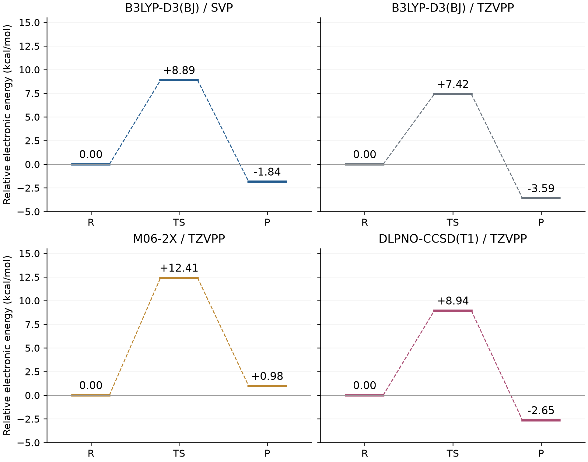

# Quantum4：自由基异构化反应的机理研究

环丙基甲基自由基开环为 3-丁烯-1-基自由基的量子化学计算与中文实验报告。体系为 C₄H₇，中性双重态，11 个原子、31 个电子、27 个振动模式。

**报告 PDF：16 页，含 10 张图、9 张表、11 条编号引文。已完成逐页检查。**

PDF 正文末尾“数据与代码”节含本仓库的可点击链接，封面保持原样。

- [在线阅读实验报告 PDF](experiment-report/radical_isomerization.pdf)
- [直接下载 PDF](https://github.com/populuscathayana/Quantum4/raw/refs/heads/main/experiment-report/radical_isomerization.pdf)
- [LaTeX 源码](experiment-report/radical_isomerization.tex)
- [环境与复现步骤](ENVIRONMENT.md) · [后处理范围](POSTPROCESS.md) · [数据与第三方说明](THIRD_PARTY_NOTICES.md)

相关实验：[Quantum1](https://github.com/populuscathayana/Quantum1) · [Quantum2](https://github.com/populuscathayana/Quantum2) · [Quantum3](https://github.com/populuscathayana/Quantum3)

## 主要结果

UB3LYP-D3(BJ)/def2-SVP 的电子势垒为 **8.89 kcal/mol**；298.15 K、1 atm 下活化 Gibbs 自由能为 **8.35 kcal/mol**，反应自由能为 **−3.35 kcal/mol**。TS 唯一开环虚频为 **−626.12 cm⁻¹**。双向 IRC 及两端优化/频率确认环状反应物与开链产物，主要自旋布居由 C9 转移至 C1。

固定同一组 B3LYP/SVP 优化几何的电子能比较，单位 kcal/mol；每行以该方法自己的反应物为零：

| 方法 | 正向势垒 | 逆向势垒 | 反应能 |
| --- | ---: | ---: | ---: |
| B3LYP-D3(BJ)/def2-SVP | 8.888 | 10.729 | −1.841 |
| B3LYP-D3(BJ)/def2-TZVPP | 7.417 | 11.012 | −3.595 |
| M06-2X/def2-TZVPP | 12.415 | 11.437 | +0.978 |
| DLPNO-CCSD(T1)/def2-TZVPP | 8.944 | 11.593 | −2.649 |



基组扩大和电子模型变化对正向势垒的影响部分抵消；M06-2X 给出更高势垒并改变反应电子能的符号。报告分别讨论 UHF 参考、线性化 CCSD 自旋期望值及 T1 诊断，不将它们混为同一种指标。这些单点比较不替代原 DFT 的几何、频率和 IRC。

## 计算内容

- UPM7 柔性扫描 1.51–3.01 Å，共 16 个接受点。原扫描尾部未收敛，保留原失败输出；一次有界修复补齐后 5 点。开环局部峰在 1.91 Å，远端强制拉伸峰不作为开环 TS 初猜。
- DFT 无约束 TS、R/P 优化与频率、波函数稳定性和自旋污染核对。
- 正向 38 点、反向 17 点 IRC；加 TS 后共 56 个独立几何的自旋布居单点。
- 真实 α−β 自旋密度的 ±0.02 e a₀⁻³ 等值面；电子能、Gibbs 自由能及热化学分解图。
- 两组三点 Gaussian 泛函/基组对照和三点 ORCA 开壳层 DLPNO-CCSD(T1) 对照。

[TS 开环模式动画](analysis/visuals/ts-opening-mode.gif) · [IRC 结构动画](analysis/visuals/irc-opening.gif)

## 快速复现

离线后处理不需要 Gaussian、ORCA 或集群连接，也不会启动新的量子计算。

```bash
git clone https://github.com/populuscathayana/Quantum4.git
cd Quantum4
python3 -m venv .venv
source .venv/bin/activate
python -m pip install -r requirements.txt

# 核验文件、驻点频率、能量差和自旋布居，导出四张数值表
python reproduce.py

# 重建八张图与两段动画
python reproduce.py --figures --animations

# 可选：安装含 ctex/Fandol 的 XeLaTeX 后重新排版报告
python reproduce.py --tex
```

每次输出到新的 `reproduced/<时间>/`，不覆盖原始计算、已核验图表或发布版 PDF。自旋密度成图随仓库保留，密度网格的重建范围见 [POSTPROCESS.md](POSTPROCESS.md)。

## 文件结构

| 路径 | 内容 |
| --- | --- |
| `experiment-report/` | 16 页 PDF、原 TeX 和全部报告图 |
| `data/calculations/` | 78 份计算输出及对应输入、Gaussian 格式化检查点 |
| `data/manifest.json` | 公开文件清单、原始/公开校验值与相对路径映射 |
| `analysis/` | 科学核验、逐点结果、文献来源、图表源数据和动画 |
| `scripts/`、`reproduce.py` | 可移植的离线核验、导出与绘图程序 |

公开副本只替换输出中的本机/集群个人路径前缀；科学数值、软件声明和原始计算状态保持不变。历史核验记录中的 `source` 与哈希指向原始项目，通过 `data/manifest.json` 可对应到本仓库文件；核验程序已处理该映射。

不上传服务器连接脚本、调度记录、密钥、二进制检查点、临时文件、软件安装包、课件或文献全文。原始工作资料另行保留。
